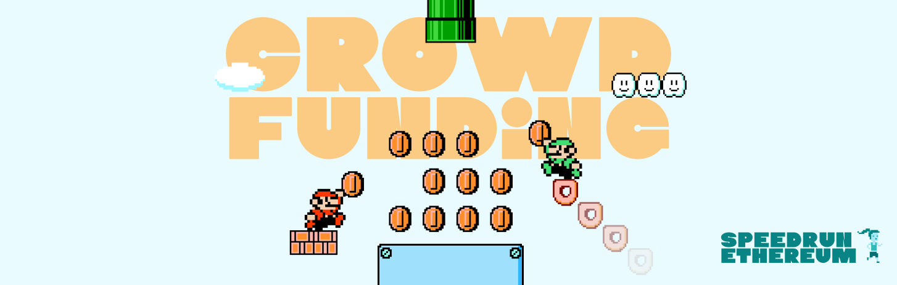

# Crowdfunding

A crowdfunding contract: contribute ETH to a goal before the deadline, or get refunded if it falls short.

- **Live demo:** https://crowdfunding-challenge-zeta.vercel.app
- **Contract (Sepolia):** [0x43642dF17c1BAa2DB9cd99fa0deEC656bf0fc632](https://sepolia.etherscan.io/address/0x43642dF17c1BAa2DB9cd99fa0deEC656bf0fc632)
- **Stack:** Scaffold-ETH 2, Foundry, Next.js, wagmi/viem

Part of [SpeedRunEthereum](https://speedrunethereum.com).
